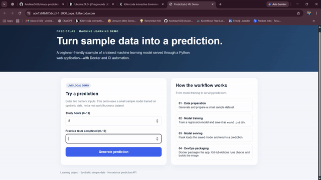
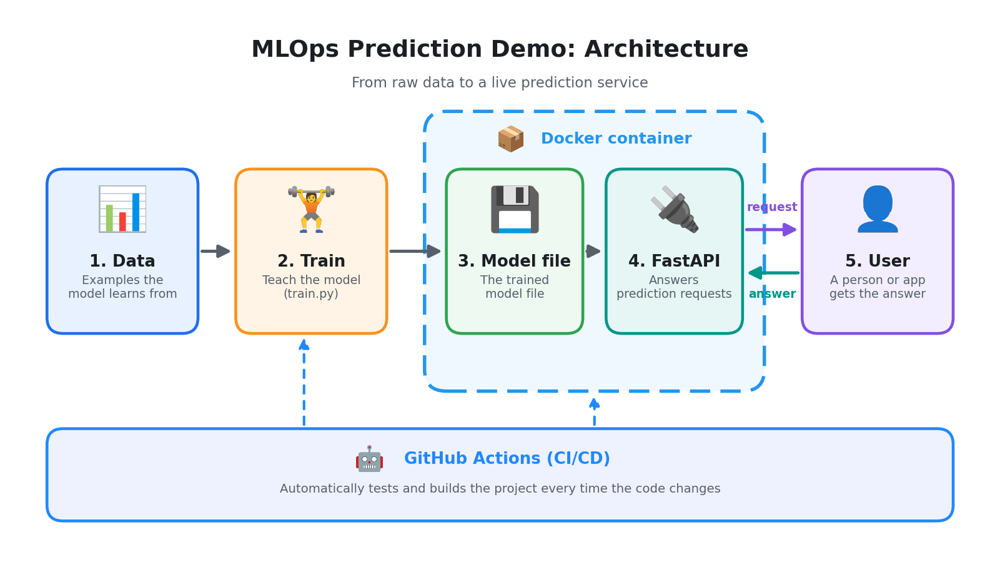
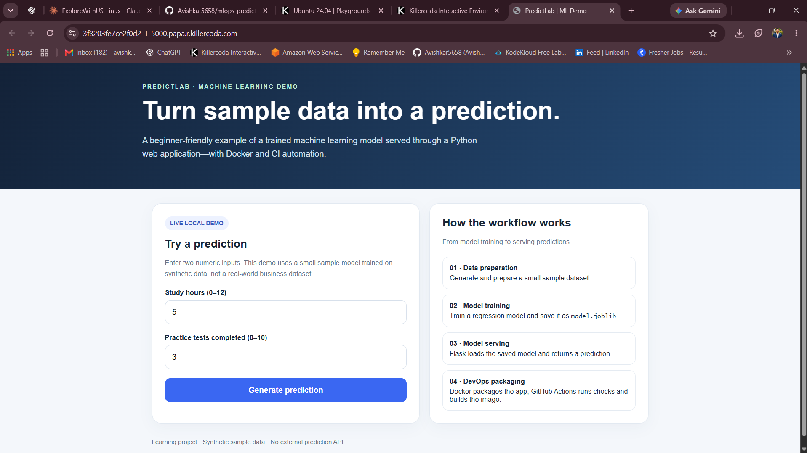
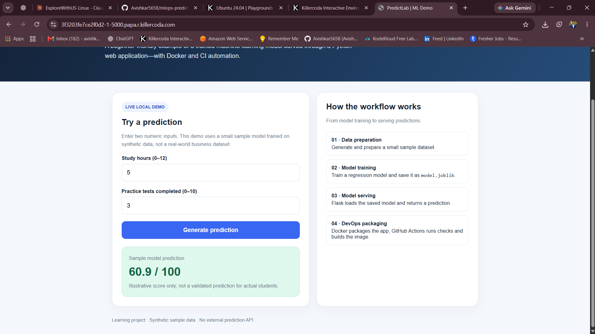

<div align="center">

# 🤖 MLOps Prediction Demo

### Turn a trained machine-learning model into a **live prediction service**: automated, repeatable, and easy to run.


<br>



<sub>👆 <b>Live demo:</b> send some data in, get the model's prediction back in a fraction of a second.</sub>

</div>

---

## 📑 Table of Contents

1. [The Problem](#-the-problem-in-plain-english)
2. [The Solution](#-the-solution)
3. [Architecture](#-architecture)
4. [Tools Used and Why](#-tools-used-and-why)
5. [How the Pipeline Works](#-how-the-pipeline-works)
6. [Demo and Screenshots](#-demo-and-screenshots)
7. [Step-by-Step: Run It Yourself](#-step-by-step-run-it-yourself)
8. [Try a Prediction](#-try-a-prediction)
9. [Challenges and What I Learned](#-challenges-and-what-i-learned)
10. [Cleanup](#-cleanup)
11. [Future Improvements](#-future-improvements)
12. [Use This Project](#-use-this-project-in-your-own-repo)

---

## 🤔 The Problem

Imagine a data scientist who builds a clever model that can **predict** something useful, for example whether a machine is about to fail or what a house might sell for.

It works great... **on their laptop.** 💻

- 😟 Nobody else can use it
- 😟 Next month, nobody remembers exactly how it was built
- 😟 Updating it by hand is slow and easy to get wrong

A model that only lives in a notebook doesn't help anyone. Companies need models that are **available to everyone, every day, and always up to date.**

## 💡 The Solution

This project shows **how it's done**, using a practice called **MLOps** (Machine Learning Operations): the "factory line" that takes a model from an idea to a working service.

> 🍕 **Pizza shop analogy**
>
> A good chef (the **data scientist**) invents a great recipe (the **model**).
> But a restaurant needs more than a recipe:
>
> - a **kitchen** that makes it the same way every time (**automation**)
> - a **menu and a waiter** so customers can order easily (**API**)
> - a **lunch box** that keeps the dish identical wherever it's delivered (**Docker**)
> - a **quality check** before anything leaves the kitchen (**tests / CI**)
>
> MLOps is building that whole restaurant, not just writing the recipe.

| Term | Simple meaning |
|------|----------------|
| 🧠 **Model** | A program that learned patterns from past data so it can make predictions |
| 🏋️ **Training** | Teaching the model using example data |
| 🔌 **API** | A "menu and waiter": a standard way for other programs to send data and get answers |
| 📦 **Docker** | A lunch box that packs the app with everything it needs, so it runs the same on any computer |
| 🤖 **CI/CD** | Robots that automatically test and ship your code every time you change it |
| 📈 **MLOps** | All of the above, working together as one reliable process |

### ✅ Result

**A model you can run with a couple of commands, and ask for predictions over the web.**

---

## 🏗️ Architecture

<div align="center">
  
</div>

**How to read the diagram (follow the arrows):**

1. 📊 **Data** goes in: the examples the model learns from.
2. 🏋️ The **training script** teaches the model.
3. 💾 The trained model is **saved to a file**.
4. 🔌 The **API** loads that file and waits for questions.
5. 📦 Everything is packed in a **Docker container** so it runs anywhere.
6. 👤 A **user** (or another app) sends data and receives a **prediction**.

---

## 🧰 Tools Used and Why

| Tool | What it is (simple) | Why it's used here |
|------|---------------------|--------------------|
| **Python** | A popular programming language | The language the whole project is written in |
| **scikit-learn** | A toolkit for building ML models | Trains the prediction model |
| **FastAPI** | A fast way to build web APIs | Lets anyone request a prediction over the web |
| **Docker** | A "lunch box" for software | Makes the app run identically on any computer |
| **GitHub Actions** | Built-in robots on GitHub | Automatically tests the project on every change |

> ✏️ *Adjust this table to match the tools your repo really uses.*

---

## ⚙️ How the Pipeline Works

The project follows a simple, repeatable path from raw data to a working service:

| Stage | What happens | Output |
|:-----:|--------------|--------|
| **1. Prepare** 📊 | Load and clean the data | Ready-to-use dataset |
| **2. Train** 🏋️ | The model learns from the data | A trained model |
| **3. Save** 💾 | The model is stored as a file | `model` file |
| **4. Serve** 🔌 | The API loads the model and answers requests | A live prediction endpoint |
| **5. Package** 📦 | Everything goes into a Docker container | A portable app |
| **6. Automate** 🤖 | GitHub Actions checks every change | Confidence it still works |

---

## 📸 Demo and Screenshots

> ✏️ *Add your own screenshots to the `screenshots/` folder and keep the file names below, or update the links.*

### 🎬 Asking the model for a prediction

<table>
  <tr>
    <td align="center" width="50%"><b>📥 Input</b><br><sub>The data we send</sub></td>
    <td align="center" width="50%"><b>📤 Output</b><br><sub>The prediction we get back</sub></td>
  </tr>
  <tr>
    <td></td>
    <td></td>
  </tr>
</table>

### 📖 The built-in interactive page

FastAPI creates a **test page automatically** at `/docs`, so you can try the model with clicks instead of code.

<div align="center">
  
</div>

### ✅ Automated checks passing

<div align="center">
  
</div>

---

## 🛠️ Step-by-Step: Run It Yourself

### ✅ Prerequisites

- [Python 3.9+](https://www.python.org/downloads/)
- [Git](https://git-scm.com/downloads)
- *(Optional)* [Docker Desktop](https://www.docker.com/products/docker-desktop/), for the container steps

---

### Step 1️⃣ — Get the code

```bash
git clone https://github.com/Avishkar5658/mlops-prediction-demo.git
cd mlops-prediction-demo
```

---

### Step 2️⃣ — Create a clean workspace (recommended)

```bash
python -m venv venv

# Mac / Linux
source venv/bin/activate

# Windows
venv\Scripts\activate
```

---

### Step 3️⃣ — Install what the project needs

```bash
pip install -r requirements.txt
```

---

### Step 4️⃣ — Train the model 🏋️

```bash
python train.py
```

You should see a message confirming the model was trained and saved.

> ✏️ *Replace `train.py` with your real training script name.*

---

### Step 5️⃣ — Start the prediction service 🔌

```bash
uvicorn app:app --reload
```

Now open **http://127.0.0.1:8000/docs** in your browser. 🎉

> ✏️ *Replace `app:app` with `<your-file-name>:<your-app-variable>`.*

---

### Step 6️⃣ — Run it in Docker 📦 *(optional)*

```bash
docker build -t mlops-prediction-demo .
docker run -p 8000:8000 mlops-prediction-demo
```

Open **http://localhost:8000/docs**. It works exactly the same, on any computer.

---

## 🎯 Try a Prediction

**Option A: click.** Open `/docs`, choose the prediction endpoint, press **Try it out**, enter values, and press **Execute**.

**Option B: terminal.**

```bash
curl -X POST http://127.0.0.1:8000/predict \
  -H "Content-Type: application/json" \
  -d '{"feature_1": 1.0, "feature_2": 2.0}'
```

**Example answer:**

```json
{ "prediction": 1 }
```

> ✏️ *Replace the field names and the example answer with the ones your model really uses.*

---

## 🎓 Challenges and What I Learned

> ✏️ *Replace the rows below with problems you actually faced. Genuine lessons stand out the most.*

| Challenge | How I solved it |
|-----------|-----------------|
| The app worked locally but not in Docker | Checked the Dockerfile, the port mapping and the installed packages |
| The API couldn't find the saved model | Made sure the model was trained and saved before starting the service |
| Wanted to be sure changes didn't break anything | Added automated checks with GitHub Actions |

**Key takeaways**

- ✅ A model is only useful when other people and programs can **use** it
- ✅ How training, saving, serving and packaging fit together
- ✅ Why **automation** makes projects repeatable and less error-prone
- ✅ How Docker removes the "it works on my machine" problem

---

## 🧹 Cleanup

When you're done experimenting:

```bash
# Stop the API: press CTRL + C in the terminal

# Remove the Docker container and image (if you used Docker)
docker ps -a
docker rm <CONTAINER-ID>
docker rmi mlops-prediction-demo
```

> 💰 This project runs on your own computer, so it costs nothing.

---

## 🔮 Future Improvements

- [ ] 📈 Track experiments with **MLflow**
- [ ] 🔔 Add **monitoring** to spot when predictions get worse over time
- [ ] ☸️ Deploy to **Kubernetes** or a cloud service (AWS, Azure, GCP)
- [ ] 🔁 Automatically **retrain** the model when new data arrives
- [ ] 🧪 Add more **automated tests**
- [ ] 🌐 Build a simple **web page** where non-technical users can try the model

---

## 🔁 Use This Project in Your Own Repo

Want to try it or add it to your own portfolio?

1. **Fork** this repository (top-right button) or download it as a ZIP
2. Follow the [step-by-step guide](#-step-by-step-run-it-yourself) on your own computer
3. Replace the screenshots in `screenshots/` with **your own**
4. Swap in **your own data and model** to make it your project
5. Write your own **Challenges and What I Learned** section
6. ⭐ If it helped you, give the repo a star!

### 📁 Repository structure

> ✏️ *Update this tree so it matches your real files.*

```
mlops-prediction-demo/
├── README.md
├── requirements.txt
├── Dockerfile
├── train.py              # Teaches the model
├── app.py                # The prediction API
├── .github/
│   └── workflows/        # Automated checks (GitHub Actions)
└── screenshots/
    ├── architecture.png
    ├── input.png
    ├── output.png
    ├── api-docs.png
    ├── ci-passing.png
    └── demo.gif
```

---

## 👤 Author

**Avishkar Thorave**

[](https://github.com/Avishkar5658)
[](https://www.linkedin.com/in/avishkar-thorve-a77a8b2a1)

---

<div align="center">

⭐ **If you found this useful, give it a star!** ⭐

*Built with 🐍 Python and a lot of curiosity.*

</div>
